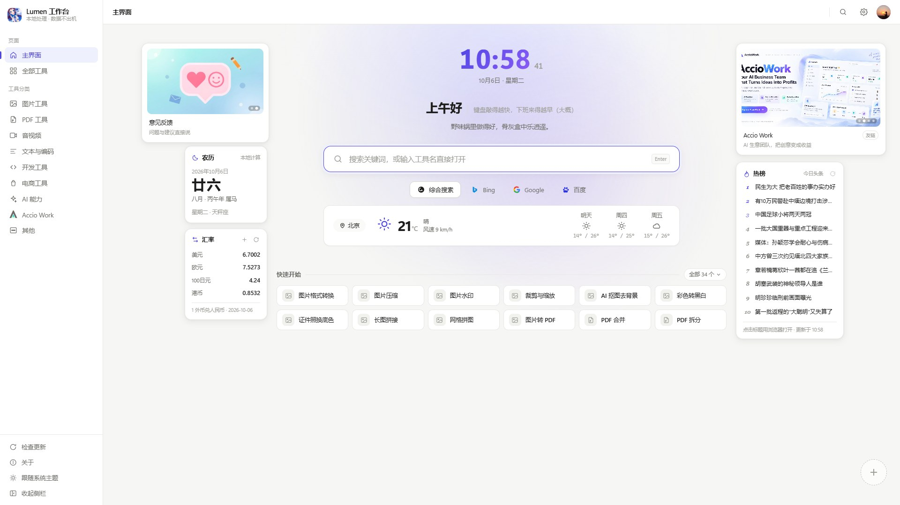

# Lumen Workbench

English | [中文](./README.zh-CN.md)

A local-first personal AI workbench for Windows. One installer, no dependencies, no account — install and go.

> Current version **v1.2.0** | 54 tools, all implemented

**Website**: [lyz0v0.github.io/lumen-workbench](https://lyz0v0.github.io/lumen-workbench/) — project introduction, feature overview and download links. Faster mirror in mainland China: [workbuddy.host](https://lumen-workbench.app.workbuddy.host/?sharecode=Z2WMEPTYQL).

## Highlights

- **Local-first**: image processing, PDF, QR code and text tools all run on your machine — files never leave your computer
- **One installer, zero dependencies**: Electron + Chromium bundled — install and go, no Java / Python / .NET / Node needed
- **Desktop island**: a capsule that lives on your desktop — clock / weather / battery / media player, physics-based dragging, dock to any screen edge, and system notifications from apps like QQ & WeChat mirrored onto the island
- **No account required**: AI features use BYOK (bring your own API key; requests are relayed by the app's main process, keys never leave your machine)
- **Data stays local**: history and AI settings live in your local user data; uninstall to wipe
- **Multi-language**: the interface supports 简体中文 / English / 日本語 — auto-detected on first launch, switchable anytime in Settings
- **In-app auto-update**: "Check for updates" downloads and upgrades in one click; your data is kept
- **Automatic fallback for free APIs**: weather / exchange rates / hot lists / parcel tracking all have backup sources or multi-level fallbacks — one failing never breaks the rest

## Home screen

- **Lunar calendar**: solar + lunar dual calendar, ganzhi & zodiac, solar terms and festivals — computed locally, no network needed
- **Live exchange rates**: 1 unit of foreign currency to CNY, pick your own currencies (up to 6); data from ECB via Frankfurter, auto-switches to a backup source on failure
- **Today's hot list**: same board as the Toutiao app; sits in the right-hand whitespace on wide windows, hides itself on failure
- **Local music**: drag songs from a folder in and use them as work BGM — played purely locally
- **Search suggestions**: typing matches tools instantly; ↑↓ to pick, Enter to open
- **Frequent tools**: auto-sorted by recent use; right-click to pin favorites
- **Startup self-check**: on launch, checks the local environment and external API health; issues light up in the sidebar with details, never blocking use

## Tools

**54 tools across 7 categories, all fully implemented — no placeholders.**

- **Images**: format conversion, compression, watermark, crop & resize, images to PDF
- **PDF**: merge, split, page editing, watermark, paging seal, compress, to images, extract text
- **AI workbench** (sidebar entry, "AI Assistant"): the assistant calls local tools right in the chat, and "use tools" mode auto-continues past the step limit to finish multi-step tasks in one run; also a prompt optimizer, image attachments, session management, a prompt library and custom skills (BYOK, multi-model / streaming / local sessions)
- **Dev tools**: UUID generator, timestamp converter, cron builder, API tester, color converter, QR code generator / scanner
- **Others**: web image extractor, video prompt helper, friend links, and more

See [Releases](https://github.com/lyz0v0/lumen-workbench/releases) for per-version changes.

## Requirements & Install

| | |
|---|---|
| OS | Windows 10 / 11 (64-bit) |
| Dependencies | None — all runtimes are bundled |

Download `lumen-workbench-setup.exe` from [Releases · Latest](https://github.com/lyz0v0/lumen-workbench/releases/latest) and double-click to install: step-by-step wizard, choose your own install location, Start Menu shortcut created automatically.

- Closing the window minimizes to the tray; right-click the tray icon to quit or open the shell status page

For development: clone the repo, put the build outputs next to `shell/` and run `npm install && npm start` (Node.js 18+).

## Notes

- Weather (Open-Meteo), exchange rates (Frankfurter), hot lists and the hitokoto quote on the home screen are free public APIs; they degrade gracefully and never break other features
- Parcel tracking uses a free aggregated API, 30 requests/day, resets the next day
- AI tools use BYOK: your own API key, requests go straight from the app's main process to the provider; this repo contains no keys and runs no proxy
- PDF, image processing and QR code generation / scanning are purely local — no third-party API involved, files never leave your machine

## Feedback

Email: rijinwe7396@163.com (the "Feedback" dialog inside the app links here too)

## Sponsor

If Lumen Workbench helps you, feel free to buy the author a coffee ☕ Your support keeps the updates coming!

  

## License

The code in this repository is **not** open source — All Rights Reserved. See [LICENSE](LICENSE).

Without the author's written permission, you may **not** copy, modify, redistribute, create derivative works of, or use this repository commercially; viewing and reading the online content of this repository for learning purposes is allowed.
