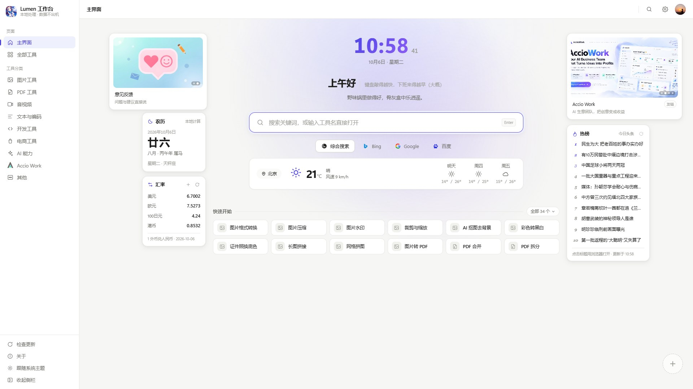

# Lumen 工作台

[English](./README.md) | 中文

本地优先的个人 AI 工作台，只做 Windows 版。一个安装包、零依赖、无需注册，装完即用。

> 当前版本 **v1.2.0** ｜ 54 个工具，全部实装

**官网**：[lyz0v0.github.io/lumen-workbench](https://lyz0v0.github.io/lumen-workbench/) —— 产品介绍、功能总览与下载入口。国内访问更快：[workbuddy.host](https://lumen-workbench.app.workbuddy.host/?sharecode=Z2WMEPTYQL)。

## 特点

- **本地优先**：图片处理、PDF、二维码、文本工具全部在本机完成，文件不上传、不经过任何服务器
- **一个安装包、零依赖**：Electron + Chromium 全部内置，装完即用，无需 Java / Python / .NET / Node
- **桌面灵动岛**：常驻桌面的胶囊——时钟 / 天气 / 电量 / 媒体播放器；弹簧拖拽手感、任意边停靠吸附，QQ、微信等应用的系统通知直接镜像到岛上
- **无需注册**：没有账号体系；AI 能力走 BYOK（自带 API Key，请求由主进程代发，密钥不出本机）
- **数据只存本机**：历史记录、AI 配置等全部保存在本地用户数据目录，卸载即清空
- **多国语言**：界面支持简体中文 / English / 日本語，首次打开自动跟随系统语言，设置里可随时切换
- **应用内自动更新**：「检查更新」即可下载并一键升级，数据全部保留
- **免费接口自动降级**：天气 / 汇率 / 热榜 / 快递等都备了备用源或多级兜底，挂了不影响其他功能

## 主界面

- **农历日历**：公历 + 农历双历、干支生肖、节气节日，纯本地计算不联网
- **实时汇率**：1 外币兑人民币，支持自选币种（最多 6 个），数据源为欧央行 Frankfurter，失败自动切换备用源
- **今日热榜**：与头条 App 同榜，窗口够宽时挂在右侧空白处，失败自动隐身
- **本地音乐**：把文件夹里的歌拖进来当工作 BGM，纯本地播放
- **搜索联想**：搜索框输入即匹配工具，↑↓ 选择回车直达
- **常用工具**：按最近使用自动排序，右键固定常用项
- **启动自检**：打开时自动检查本机环境与外部接口健康度，异常就在侧栏亮灯，可点开看明细，不阻塞使用

## 工具

共 **54 个工具、7 个分类，全部实装、零占位**。

- **图片**：格式转换、压缩、水印、裁剪缩放、图片转 PDF
- **PDF**：合并、拆分、页面编辑、水印、骑缝章、压缩、转图片、提取文字
- **AI 工作台**（侧栏一级入口，「AI 助手」）：对话里直接使唤本机工具，「用工具」模式把多步任务当场做完（步数不够自动续跑），自带提示词优化，支持图片附件、会话管理、提示词库与自定义技能（BYOK，多模型 / 流式 / 本地存会话）
- **开发工具**：UUID 生成器、时间戳转换、Cron 表达式、API 测试、颜色取色转换、二维码生成 / 解码
- **其他**：网页图片提取、视频生成提示词、友情链接等

各版本的更新内容见 [Releases](https://github.com/lyz0v0/lumen-workbench/releases)。

## 系统要求与安装

| | |
|---|---|
| 操作系统 | Windows 10 / 11（64 位） |
| 依赖 | 无——运行时全部内置 |

在 [Releases · Latest](https://github.com/lyz0v0/lumen-workbench/releases/latest) 下载 `lumen-workbench-setup.exe`，双击安装：分步向导、可自选安装位置、自动生成开始菜单快捷方式。

- 关闭窗口缩到托盘常驻，右键托盘图标可退出或打开状态页

开发调试：克隆仓库，把构建产物放到 `shell/` 旁，`npm install && npm start`（需 Node.js 18+）。

## 说明

- 主界面的天气（Open-Meteo）、汇率（Frankfurter）、热榜、一言均为免费公开接口，失败会自动降级，不影响其他功能
- 快递查询使用免费的聚合接口，每天 30 次额度，超了次日恢复
- AI 工具走 BYOK：自带 API Key，请求由主进程直连服务商，本仓库不含任何 Key 与代理服务
- PDF、图片处理、二维码生成 / 解码等均为纯本地实现，不依赖任何第三方接口，文件不出本机

## 反馈

邮箱：rijinwe7396@163.com（应用内「意见反馈」弹窗也可一键直达）

## 赞助

如果 Lumen 工作台帮到了你，欢迎请作者喝杯奶茶 ☕ 你的支持是我继续更新的动力～

  

## License

本仓库代码不使用开源协议，保留所有权利（All Rights Reserved）。详见 [LICENSE](LICENSE)。

未经作者书面许可，**禁止**复制、修改、二次分发、二次开发及任何商业用途；仅允许查看与本仓库在线内容的学习性阅读。
